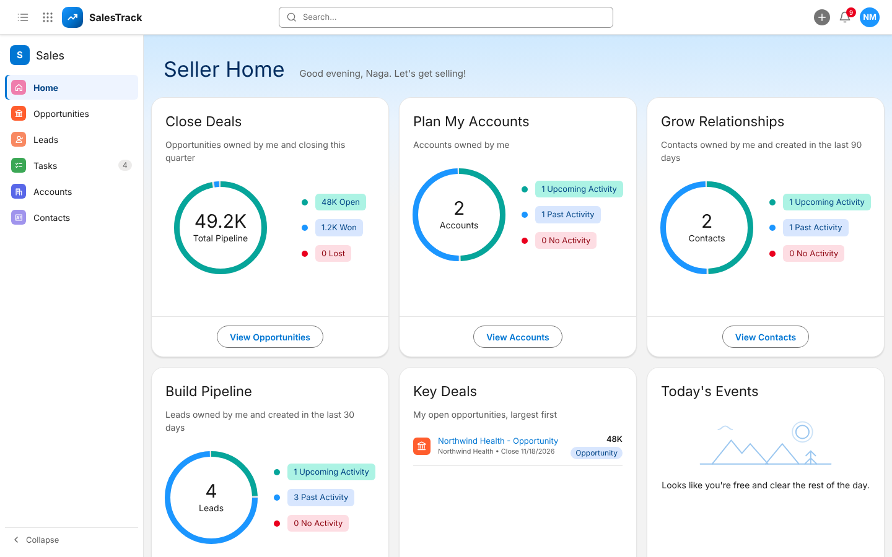

# SalesTrack CRM

SalesTrack is a web-based Customer Relationship Management (CRM) application for managing the sales cycle from first
enquiry to a won or lost deal. It is modeled on Salesforce Sales Cloud: leads, opportunities, accounts, contacts and
tasks, with role-based access, automated follow-ups, notifications and email.



## Demo

[Watch the SalesTrack demo video (17 min)](https://srsconsultinc-my.sharepoint.com/personal/nagamani_ch_srsconsultinginc_com/_layouts/15/stream.aspx?id=%2fpersonal%2fnagamani_ch_srsconsultinginc_com%2fDocuments%2fSalesTrack_CRM+application.mov&share=cQqXZCWENaJQT63KiSb3KpnnEgUBgmKLffuHpxHn7NkSH7kzgg) (SRS Consulting sign-in required)

Walkthrough of the Admin, Salesperson and Manager roles: user management and permissions, lead creation, stage flow,
email, tasks and reminders, notifications, lead conversion, closing a deal, and the manager's team view.

## Contents

- [Demo](#demo)
- [Features](#features)
- [Tech stack](#tech-stack)
- [Getting started](#getting-started)
- [Configuration](#configuration)
- [Sales process](#sales-process)
- [Roles and permissions](#roles-and-permissions)
- [Running tests](#running-tests)
- [Project structure](#project-structure)
- [Known limitations and roadmap](#known-limitations-and-roadmap)

## Features

**Sales pipeline**
- Leads and opportunities with list views, search, sorting and an opportunity Kanban board.
- Stage path on every record, with enforced stage order and a full stage history.
- One-step lead conversion into an Account, a Contact and an Opportunity.
- Automatic follow-up tasks and reminders at each stage.
- One lead per email: an email already on any lead or contact can't be used again (the user is told whose record
  it is).
- Work emails only: a personal mailbox (gmail.com, yahoo.com, outlook.com, hotmail.com and similar) is refused. An
  email on a different company domain than the Company Website (e.g. @srsconsultinginc.com for srsconsultingus.com)
  is asked about once and saved with **Save anyway**.
- Unqualified (with a reason; can be reopened later) and Revisit (a date and reason to come back) for leads that
  aren't ready now.
- Transfer a lead or opportunity (single or bulk, by the owner, a Manager or the Admin): it keeps its stage, and the
  new owner gets the open follow-up tasks, reminders and due dates, plus a notification with the stage, last note
  and open tasks. Every transfer is kept in Transfer History.
- Opportunity attachments: PDF, Word (.docx), JPG and PNG files (20 MB each) added at the Opportunity and Proposal
  stages, kept with their stage, and viewable after the deal closes. Files can also be chosen in the Change Stage
  popup; they are saved together with the stage change and labelled with the new stage. Files chosen in the Mark as
  Won popup are saved together with the win and labelled Proposal.
- Lead research fields: LinkedIn profile, company website, company LinkedIn page (clickable, required with email),
  turnover, headcount and location.
- LinkedIn autofill on New Lead: paste a LinkedIn profile URL and the empty fields are filled with the details Apollo
  returns (name, title, a work email Apollo marks verified, direct business phone, and the current employer's
  company name, industry, website and LinkedIn page). These are Apollo's data, not checked by the CRM: review them
  before saving. Nothing is saved until Save; off until `APOLLO_API_KEY` is set.
- Delete a lead (owner, Manager or Admin); the Admin and Managers are notified and it is logged.
- While typing the company on a lead, existing leads and accounts for that company are shown (only owner and stage
  for records the user can't open), so two people don't work the same company.

**Email campaigns** (sent through Outlook)
- Two ways to choose recipients: tick leads in the Leads list and use **Actions > Email Campaign**, or
  **Email Campaigns > New Campaign** and type or paste addresses in the **To** field (each becomes a chip; invalid
  ones are marked in red). Recipients don't need to be in the CRM; an address that belongs to one of the user's leads
  is treated as that lead. (Choosing leads by stage is switched off in the app: `STAGE_PICKER` in `CampaignsPage.jsx`.)
- Merge fields in the subject and message: first name, last name, full name, company and the sender's name, with a
  preview before sending. Missing values fill themselves: the company from the email's domain
  (`asha@acme-retail.com` -> "Acme Retail"), the name from the address. Send now or at a set time.
- Paced under Outlook's limits (20 a minute and 1,800 a day by default), with automatic retries (after 5 minutes,
  30 minutes and 2 hours) and a progress page per campaign. If the mailbox settings are wrong, campaigns pause and
  the sender is notified.
- Campaign emails end with **Unsubscribe** and **Subscribe** links until the person clicks Subscribe; after that
  only with **Unsubscribe** (the lead's owner is told when a lead subscribes or unsubscribes). Outlook's one-click unsubscribe header is on every email. Each link
  opens a page that asks first, with **Cancel**, before anything changes.
- Unsubscribed addresses, leads with no email and invalid emails (no mail server for the domain, or rejected by the
  mail server) are left out of every campaign and listed as "left out" with the reason. One opt-out covers the
  address everywhere: typed in, and on any lead with that email.
- Campaign totals on the Email Campaigns page: **Sent**, **Queued**, **Bounced** (with the bounce rate), **Failed**,
  **Unsubscribed** (people who unsubscribed after a campaign) and **Not sent** (excluded at send time). Every number
  opens its list.
- Leads list views for campaigns: **Working Emails**, **Invalid Emails**, **Unsubscribed Leads** and **No Email**.

**Bulk upload and download**
- Upload up to 100,000 leads at a time from Excel (.xlsx) or CSV. The file is checked
  first (rows ready, duplicates of open leads, invalid rows), then uploaded. No emails are sent to uploaded leads.
- Uploaded leads appear in the normal lead lists with Lead Source **Upload**, and in the **Uploaded Leads** list view.
  Only Last Name and Company are required; a wrong email, link or number is left blank (and listed) instead of
  skipping the row, so the salesperson can fill it in later. A personal email (gmail.com...) is left blank; an email
  on a different company domain than the website is kept with a "Check" note.
- The Leads list loads page by page (100 rows) with server-side search and sorting, so it stays fast with 100,000s of leads.
- Column filters (the arrow in a column header) on Leads, Opportunities, Accounts, Contacts and Tasks: status/stage,
  source, owner, priority, type and date ranges (created, close date, due date).
- Upload opportunities (deals) the same way; the company becomes an account and a contact is added when given.
- Download leads or opportunities to Excel or CSV with a filter (e.g. Won, Lost, Open) and a required reason.
- **History** on the Leads and Opportunities lists shows who uploaded or downloaded, when, what and why.
- Every upload and download is recorded in the Activity Log (who, when, what, how many, reason); the Admin is notified of downloads.

**Access control**
- Role-based access (Salesperson, Manager, Admin) with a configurable **Roles & Permissions** matrix.
- Record-level visibility: salespeople see only their own records unless a Manager grants team access.
- All rules are enforced in the API, not only in the UI.

**Notifications and email**
- In-app notifications (bell and pop-ups) with a 30-day history, plus due-date reminders.
- Per-user email notification preferences.
- Send emails with attachments from any record, through the CRM mailbox or the user's own Outlook. Every email is logged on the record.
- Automatic no-reply emails to customers when a lead is created, won or lost (optional per action).

**Administration**
- User management: create users, assign roles, reset passwords, deactivate users and transfer their records.
- Welcome email with login details for new users; self-service profile and password change.

## Tech stack

| Layer | Technology |
| --- | --- |
| Frontend | React 19, Vite 6, CSS |
| Backend | Python 3.12, FastAPI, SQLAlchemy 2, Pydantic |
| Database | PostgreSQL 16 |
| Authentication | Token-based login, bcrypt password hashing |
| Email | Microsoft 365 / Outlook (Microsoft Graph) or SMTP; Mailpit for local testing |
| Deployment | Docker Compose, nginx |
| Testing | Pytest (backend), Node test runner (frontend) |

## Getting started

Deploying on a server: see **[DEPLOY.md](DEPLOY.md)** (settings, Outlook email, HTTPS, updates and backups).

### Prerequisites

- Docker Desktop
- Git

### Installation

1. Clone the repository:
   ```
   git clone https://github.com/manic-srs/CRM-application.git
   cd CRM-application
   ```
2. (Optional) Create the environment file and update the values (see [Configuration](#configuration)):
   ```
   cp .env.example .env
   ```
   Without a `.env` file, all outgoing email is captured by the local test inbox.
3. Build and start the services:
   ```
   docker compose up -d --build
   ```

### Services

| Service | URL |
| --- | --- |
| Application | http://localhost:5173 |
| API documentation (Swagger) | http://localhost:8001/docs |
| Test mail inbox (Mailpit) | http://localhost:8026 |
| PostgreSQL | `localhost:5433` (database `crm_db`) |

### First login

1. Sign in with the default Admin account defined by `ADMIN_EMAIL` / `ADMIN_PASSWORD`
   (default `admin@salestrack.local` / `Admin@2026`).
2. Change the default password from the profile menu → **Change Password**.
3. Go to **Users** → **New User** to add Managers and Salespeople.

The database starts empty and is upgraded automatically on startup. Data is persisted in a Docker volume.

### Common commands

| Command | Description |
| --- | --- |
| `docker compose up -d --build` | Build and start (or restart after code changes) |
| `docker compose down` | Stop the services (data is kept) |
| `docker compose down -v` | Stop the services and delete all data |
| `docker compose logs api --tail 50` | View backend logs (including the campaign sender) |

## Configuration

Settings are read from `.env` in the project root. This file is excluded from version control.

| Variable | Description |
| --- | --- |
| `MAIL_PROVIDER` | `smtp` (default) or `graph` |
| `SMTP_HOST`, `SMTP_PORT`, `SMTP_TLS`, `SMTP_USER`, `SMTP_PASSWORD` | Outlook SMTP (`smtp.office365.com`, port 587, TLS). Without them, all email goes to the local Mailpit inbox |
| `MS_TENANT_ID`, `MS_CLIENT_ID`, `MS_CLIENT_SECRET` | Outlook through Microsoft Graph (`MAIL_PROVIDER=graph`; an Azure app registration with `Mail.Send`). Recommended for production: Microsoft is turning off basic-auth SMTP |
| `MAIL_FROM` | Sender address for all outgoing email |
| `COMPANY_NAME` | Company name shown in customer emails |
| `ADMIN_EMAIL`, `ADMIN_PASSWORD` | Default Admin account created on first start |
| `SECRET_KEY` | Secret used to sign login tokens (use a long random value) |
| `APP_URL` | Base URL used in email links (default `http://localhost:5173`) |
| `PUBLIC_URL` | Address of the app that leads can open, used by the Unsubscribe / Subscribe links in campaign emails (falls back to `APP_URL`; must not be localhost on a server) |
| `CAMPAIGN_PER_MINUTE`, `CAMPAIGN_PER_DAY` | Campaign sending pace (defaults 20 and 1,800; Microsoft 365 allows 30 a minute and 2,000 external recipients a day per mailbox) |
| `CAMPAIGN_CHECK_DOMAINS` | Check that a lead's email domain has a mail server before sending (default `true`) |
| `APP_PORT`, `API_PORT`, `DB_PORT`, `MAILPIT_PORT` | Ports for the app, API, database and test inbox (defaults 5173, 8001, 5433, 8026) |
| `APOLLO_API_KEY` | LinkedIn autofill on New Lead (Apollo People Enrichment). Backend only; matched lookups can use Apollo credits |

Apply changes with `docker compose up -d`.

## Sales process

```
Lead:         New -> Nurturing -> Revisit (optional) -> Demo -> Convert
Opportunity:  Opportunity -> Discovery -> Proposal -> Won
Lost:         available from any open stage (reason required)
Unqualified:  available from any open lead stage (reason required); the lead can be reopened
```

| Stage | System behavior |
| --- | --- |
| New | Creates a "Make first contact" task |
| Nurturing / Demo | Closes the previous follow-ups and saves the user's new task; with a demo date, the demo reminder (1 hour before) and a preparation task |
| Revisit | Needs a date to come back and a reason (bad timing, budget next period, asked to call back...); the follow-up task is due on that date |
| Unqualified | Closes the lead with a reason (not a fit, no budget, no authority...) and closes its open tasks; **Reopen** brings it back to New |
| Convert | Creates the Account, Contact and Opportunity (the user's new task goes on the opportunity); moves lead emails to the opportunity |
| Discovery | Records the customer's needs, budget, decision maker and timeline; sets probability to 40% |
| Proposal | Sets probability to 75%, saves the user's new task; the close-date reminder stays |
| Won / Lost | Closes the deal and its open tasks; Won saves the user's post-sale task, which stays open; optional customer email |

**Stage order.** Stages cannot be skipped. Moving forward past a stage requires the user to confirm that stage as
completed, with an optional note recorded in the stage history. Moving back and marking Lost are always allowed.
Implemented in `backend/app/services.py` (`confirm_skipped`).

**Stage notes.** Every stage change a user makes needs a note: the Change Stage popup (path, Mark as Complete, Kanban),
the Conversion Comment on Convert ("Enter a conversion comment."), the Closing Note on Won, the Lost Notes on Lost
(with the Lost Reason), and the reason when a cancelled demo
moves the lead back to Nurturing. The API refuses a missing or blank note and then changes nothing. The note is saved
in the stage history (on conversion also as the new opportunity's first entry). Creating a record needs no note.
Implemented in `backend/app/schemas.py` (`StageNote`).

**New task with each stage change.** Every stage change except Lost also needs a New Task (subject and due date;
priority, assignee, reminder and description as on the task form), in the same popup below the note: the next
follow-up, the first task of the new opportunity on Convert, or a post-sale task (e.g. handover) on Won, which stays
open on the won deal. It replaces the system's automatic follow-up for that change; reminders tied to dates (demo,
close date) stay. It goes to the record's owner unless a user who may assign tasks picks someone else. The change,
note, task and any files are saved together or not at all. Implemented in `backend/app/schemas.py` (`StageTask`) and
`backend/app/services.py` (`add_stage_task`).

**Bulk upload.** Leads > Upload accepts .xlsx or .csv files with up to 100,000 rows (50 MB). Common column names
are recognised (First Name, Last Name, Title, Company, Email, Person Linkedin Url, Website, Company Linkedin Url,
Annual Revenue, # Employees, City, State, Country). Last Name and Company are required. Rows whose email or LinkedIn
profile already belongs to an open lead are skipped. Implemented in `backend/app/routers/lead_files.py`.

**One lead per email.** An email can belong to one lead only: a lead can't be created or edited with an email that is
already on another lead (any stage) or a contact. The message names the record and its owner (only the owner for
records the user can't open). Implemented in `backend/app/routers/leads.py` (`check_email_free`).

**Lead email domain.** The email should be on the company's domain (as its Company Website; subdomains count).
Personal mailboxes are refused. Another company domain is asked about once, then saved with **Save anyway** (some
companies email from one domain and host their website on another). Implemented in `backend/app/services.py`
(`email_website_problem`, `is_personal_email`).

**Transfer.** A transferred lead or opportunity continues at its current stage. The new owner gets all open
follow-up tasks with their reminders and due dates (the previous owner's and the system's), and a notification
with the stage, the last note, the open tasks and the transfer note. Bulk transfers and the Admin's "transfer a
user's records" work the same way and are listed in Transfer History. Implemented in `backend/app/services.py`
(`reassign_system_tasks`, `handover_lines`).

**Email campaigns.** The sender runs every minute in the API and sends up to `CAMPAIGN_PER_MINUTE` emails, never more
than `CAMPAIGN_PER_DAY` in 24 hours across all campaigns. Failed sends are retried 3 times; an address the mail
server rejects (550 / 5.1.x) is marked invalid and left out of later campaigns. Unsubscribe links are signed, so they
can't be guessed for another lead. Implemented in `backend/app/campaigns.py` and
`backend/app/routers/campaigns.py`. Setting up Outlook for campaigns: see [DEPLOY.md](DEPLOY.md).

## Roles and permissions

| Role | Default access |
| --- | --- |
| Salesperson | Views and edits own leads, opportunities, accounts, contacts, tasks and emails |
| Manager | Views and edits all records, reassigns owners, grants team access to salespeople |
| Admin | Full access, including user management and the permissions matrix |

- **Roles & Permissions** (Admin): enable or disable each permission for the Salesperson and Manager roles. Admin permissions are fixed.
- **Team access** (Users page): grants a salesperson read-only access to all team records.
- Records outside a user's access are hidden from lists, search, dashboards and direct links.

Access rules are implemented in `backend/app/security.py`.

## Running tests

```
docker compose exec api pip install -q pytest httpx
docker compose exec -e MAIL_ASYNC=false api pytest -q   # backend
cd frontend && npm test                                  # frontend
```

Backend tests run against a temporary database and do not send real email.

## Project structure

```
CRM-application/
├── backend/              FastAPI application (routers, models, security, email, scheduler, tests)
├── frontend/             React application (pages, components, styles)
├── database/             PostgreSQL schema, views and optional seed data
├── docker-compose.yml    Database, API, frontend and mail inbox services
└── .env.example          Environment variable template
```

See [backend/README.md](backend/README.md) and [frontend/README.md](frontend/README.md) for module details.

## Known limitations and roadmap

**Limitations**
- Runs as a single local deployment; a shared database or hosted environment is required for multi-user access across machines.
- Production email requires a Microsoft 365 mailbox (SMTP or Graph with an Azure app registration).
- Campaign emails are plain text; a mailbox can send to about 2,000 external recipients a day.
- Customer replies are not synced back into the CRM.
- Self-service password reset is not available; passwords are reset by an Admin.

**Roadmap**
- AI assistant to draft follow-up emails from a previous conversation
- Email templates
- Inbound email sync

## AI email drafting

In **New Email → Message**, type directly into **Describe your change** at the bottom
of the message box. Press **Enter** or click the wand to generate a subject and message.
The compact bar keeps **Describe your change**, **Polish** and its three-dot menu on one row, with Undo/Redo beside it. The **Polish** button opens three options for the current draft: **Formalize**,
**Friendly**, and **Shorten**. These rewrite the existing message while preserving its
meaning and factual details. A supplied subject is retained; a blank subject can be
filled in. The server adds the sender signature once. There is no stage dropdown or
stage-specific suggestion list; the backend still reads the latest saved CRM stage
for context when generating a new email.

Type a custom request to compose an email or describe a change to the current draft.
Click **×** beside the bar to hide the AI controls without closing the composer or
changing the email. **Help me write** reopens them. Closing during generation cancels
applying that response. **Undo draft** restores the subject and message before the
last AI change; **Redo draft** reapplies it. Manual edits disable history actions that would overwrite those edits. Sending remains explicit.

The LLM receives the lead lifecycle (New → Nurturing → optional Revisit → Demo →
Converted, with Unqualified/Lost outcomes) and opportunity lifecycle (Opportunity →
Discovery → Proposal → Won, with Lost outcomes). Conversion is not a won deal.
Polish actions require an existing message and AI mode; sample mode does not rewrite
user content.

Example: "Write a friendly follow-up asking about their priorities. Keep it under 100 words."

Drafts are instructed to use professional B2B sales language: a clear subject, a concise
customer-focused opening, short paragraphs, and one polite next step appropriate to the
sales stage. They avoid slang, hype, pressure, invented claims, and internal CRM terminology.
Always review the draft for factual accuracy before sending.

The generated subject and message appear directly in the existing composer and remain
editable. **Undo draft** restores the previous email until you manually edit the generated
text. Cancellation or generation errors preserve the existing email. Sending remains a
separate **Send** / **Open in Outlook** action.

Enable real AI generation in the root `.env` beside `docker-compose.yml`:

```dotenv
EMAIL_DRAFT_MODE=openai
OPENAI_API_KEY=your-openai-api-key
OPENAI_EMAIL_MODEL=gpt-4.1-mini
```

Run `docker compose up -d --build` after changing mode or model. Docker mounts the root
`.env` file as a read-only secret at `/run/secrets/ai_settings`. The key is not copied into
images, frontend code, or Docker environment configuration. It is read into backend memory
and sent to OpenAI as an authorization header. Never commit `.env` or put the key in a
`VITE_` variable. A backend run directly with Uvicorn can use backend environment variables.

The backend uses the OpenAI Responses API with structured subject/body output and
`store: false`. Requests include the description and minimal customer context (name,
company when available, and actual CRM stage). Existing email text, attachments, internal
notes, lost reasons, and email history are not included by this input. The sender signature
is added locally. Access requires email permission and access to the related CRM record.
The legacy sample-mode API remains available for backend tests; free-text instructions
require AI mode. No API call sends an email or changes the CRM stage.
