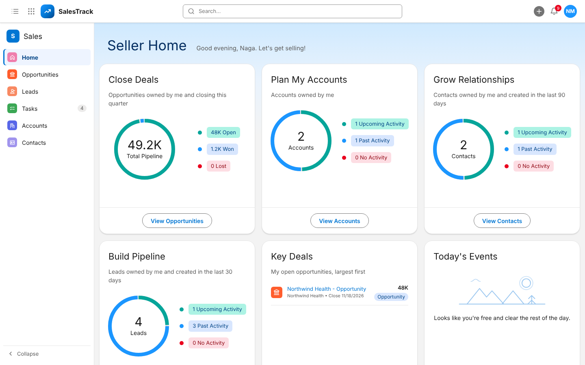

# CRM Frontend

React app for our CRM POC. The screens follow Salesforce Lightning (Sales app), and all data comes from the backend API.

## Run

The easiest way is Docker from the main project folder. It starts the database, the API and this app together:

```
docker compose up --build
```

Then open http://localhost:5173, click **Sign Up** to create your account, and log in.

To run only the frontend while the API is already running on port 8001:

```
cd frontend
npm install
npm run dev
```

Calls to `/api` are forwarded to `http://127.0.0.1:8001` (see `vite.config.js`). To use a different API address, copy `.env.example` to `.env.local` and change `API_PROXY_TARGET`.

## Screens



| Screen | What it shows |
| --- | --- |
| Login / Sign Up | Log in, or create an account (`POST /api/auth/signup`) |
| Home (Seller Home) | Close Deals, Plan My Accounts, Grow Relationships, Build Pipeline, Key Deals, Today's Events, Today's Tasks, Recent Records and Assistant, for the logged-in user |
| Leads | List views (All Open Leads, My Open Leads, Converted, Lost), sort, search, New |
| Lead page | Highlights, path (New → Nurturing → Demo → Converted), Convert, Mark as Lost, Details and Activity tabs, notes, stage history |
| Opportunities | Table or Kanban (drag a deal to change its stage) |
| Opportunity page | Path (Opportunity → Proposal → Won), Mark as Won / Lost, Activity, Details |
| Accounts / Contacts | Lists and record pages with related contacts and opportunities |
| Tasks | My Open Tasks, Today, Overdue, Completed, All; complete with the checkbox |
| Send Email | From a lead, opportunity, contact or account: To, Cc, subject, message and attachments; sent emails show on the record |

More screenshots in `docs/`: [lead page](docs/lead-page.png), [send email](docs/send-email.png), [opportunity Kanban](docs/opportunities-kanban.png), [App Launcher](docs/app-launcher.png), [login](docs/login.png).

The left side panel has the main pages (it can be collapsed). The 9 dots open the App Launcher with every page plus the test inbox and API docs.
The header has global search (`GET /api/search`), a + menu for new records, the notification bell for the logged-in user, and Log Out.
Every notification, task, Assistant item and Home card opens the record it is about.

## Files

| File | Purpose |
| --- | --- |
| `src/App.jsx` | Login check, page routing, dialogs and messages |
| `src/Header.jsx` | Top bar, App Launcher, search, + menu, bell, user menu, and the side panel |
| `src/Login.jsx` | Login and Sign Up |
| `src/Email.jsx` | Send Email (with attachments) and the list of sent emails |
| `src/SellerHome.jsx` | Home page cards |
| `src/ListView.jsx` | List views and the opportunity Kanban |
| `src/RecordPage.jsx` | Lead and opportunity pages |
| `src/RelatedPages.jsx` | Account and contact pages |
| `src/TasksPage.jsx` | Tasks list |
| `src/Modal.jsx` | Create / edit forms and stage actions (convert, won, lost, stage change, note) |
| `src/api.js` | API calls and request/response mapping |
| `src/useWorkspace.js` | Loads and refreshes data from the API |
| `src/domain.js`, `src/format.js` | Dropdown values and display formatting |
| `src/ui.jsx` | Icons, ring charts, path bar and other small pieces |

## Tests

```
npm test            # unit tests
npm run build       # production build
```

`npm run test:integration` runs a full lead-to-won flow against a running API. It creates records, so only point it at a test database:

```
CRM_TEST_ORIGIN=http://127.0.0.1:5173 npm run test:integration
```

## Notes

- The logged-in user is remembered in the browser. The backend does not issue tokens yet, so this is not real security.
- Amounts are shown without a currency symbol because the database has no currency field.
